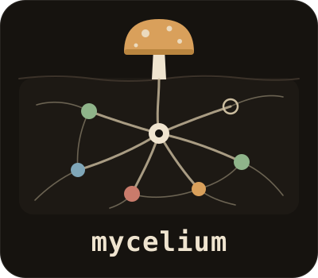

<div align="center">



# mycelium

Live, named handles on the components of a codebase, so an agent can ask for "the settings dialog" and get back exactly its code, from every file it spans, without searching for it. The names keep pointing at the right code as it's edited, split, renamed and moved.

</div>

## Why

An agent asked to change "the settings dialog" usually starts by searching for it, and in a real app the answer is spread across several files: the component, its stylesheet, a hook, a defaults file, the toggle it renders. mycelium gives each component a name and works out its extent from the code itself. The agent keeps a one-line-per-component catalog in context, and when it needs one, `myc show <slug>` returns all of it in one call.

Only a component's root declaration is stored. The files it owns, the ones it shares, and the components it renders are traced from the import graph on every lookup, so they can't go stale.

## Install

Needs [bun](https://bun.sh).

```sh
make
```

This builds a single `myc` binary and installs it to `~/.local/bin`. `make update` rebuilds and reinstalls it, and `make test` runs the typecheck and the test suite.

## Quick start

From anywhere inside a project (or with `-C <dir>`):

```console
$ myc scan
src/app/page.tsx#Home                           screen              → home-page
src/components/Card.tsx#Card                    component           → card
src/components/ToggleSwitch.tsx#ToggleSwitch    component           → toggle-switch
src/settings/SettingsDialog.tsx#SettingsDialog  component           → settings-dialog
src/settings/SettingsDialog.tsx#SettingsBadge   component           → settings-badge

5 unregistered. Register one with: myc add <slug> <file#Symbol> --note "<what it is>"

$ myc add src/components/ToggleSwitch.tsx --note "on/off switch with a label"
$ myc add src/settings/SettingsDialog.tsx#SettingsDialog --note "preferences modal with tabs and toggles"

$ myc list
settings-dialog — preferences modal with tabs and toggles
toggle-switch — on/off switch with a label
```

`myc list` is the catalog to put in an agent's context: about 15 tokens per component. `show` returns the component itself:

```console
$ myc show settings-dialog
settings-dialog — Settings dialog  [ok]
preferences modal with tabs and toggles

root     src/settings/SettingsDialog.tsx#SettingsDialog:16
files    src/settings/SettingsDialog.tsx:1,3-24
         src/settings/SettingsDialog.module.css
         src/settings/defaults.ts
         src/settings/useSettings.ts
uses     toggle-switch
shared   src/lib/cn.ts
used by  src/app/page.tsx (home-page)

── src/settings/SettingsDialog.tsx:1,3-24
import styles from "./SettingsDialog.module.css";
// …
import { useSettings } from "./useSettings";
...
```

`SettingsDialog.tsx` also declares `SettingsBadge`, so only lines 1 and 3–24 belong to the dialog. Line 2 is the badge's own stylesheet import, and `// …` marks the gap. `ToggleSwitch` is registered separately, so the dialog lists it under `uses` and stops tracing there. `cn.ts` is imported from elsewhere in the app too, so it's linked under `shared` rather than included.

After edits, `check` finds every component again:

```console
$ myc check
changed   home-page        changed src/app/page.tsx
relinked  settings-dialog  src/settings/SettingsDialog.tsx#SettingsDialog → src/settings/SettingsDialog.tsx#PreferencesDialog (renamed)
ok        toggle-switch

2 changed since last recorded; myc check --update records them
```

## Commands

| Command | What it does |
|---|---|
| `myc list` | The catalog: `slug — note`, one line per registered component. |
| `myc search <words>` | Registered components by name, alias, note, tag or path, with typo suggestions. |
| `myc show <slug>... [--no-code]` | A component's code from every file it spans, root first, plus what it uses and what uses it. |
| `myc scan [--all]` | Components in the code that aren't registered yet, with suggested slugs. `--all` includes unexported ones. |
| `myc add [<slug>] <file[#Symbol]>` | Register a component by its root declaration. With no `#Symbol`, the file's only (or default) component is used. Takes `--name`, `--note`, `--tags a,b`, `--alias <name>`, `--pin <file>` and `--example '<name>={json props}'` (repeat `--alias`, `--pin` and `--example` for more than one). |
| `myc edit <slug>` | Change an entry: `--name --note --tags --alias --unalias --root --pin --unpin --example --unexample`. |
| `myc check [--update]` | Re-find every component after edits. `--update` records the new state. Exits 1 if any component is orphaned. |
| `myc remove <slug>` | Unregister a component. The code is untouched. |
| `myc play [--port 4777]` | Serve every component rendered live from the code, with its examples. See [Live rendering](#live-rendering). |
| `myc mcp` | Serve the commands above as MCP tools over stdio. |

Every command takes `--json` for machine-readable output and `-C <dir>` to run against another directory.

## MCP server

`myc mcp` gives agents the same commands as tools: `list`, `search`, `show`, `scan`, `add`, `edit`, `check`, `remove` and `play`, which starts the playground inside the server and returns its URLs (it stops when the client disconnects). They return the text the CLI prints (pass `json: true` for JSON), and each takes `dir` to point it at a project other than the one the server started in. Errors come back as tool errors with the CLI's message, typo suggestions included.

```sh
claude mcp add mycelium -- myc mcp
```

Or in any client's config:

```json
{ "mcpServers": { "mycelium": { "command": "myc", "args": ["mcp"] } } }
```

## Live rendering

`myc play` renders every registered component from its actual code, the way a component library's demo pages do. Nothing is a screenshot. Each page is bundled with Bun when it loads, so it always shows the current code, and it reloads itself when a file changes.

```sh
myc edit card --example 'basic={"title":"Hello"}' --example 'long={"title":"A much longer title"}'
myc play
# myc play: http://localhost:4777/  (12 components; Ctrl-C stops it)
#   http://localhost:4777/c/card
```

- `/` shows every component side by side; `/c/<slug>` renders one with all its examples; `/c/<slug>?example=<name>` renders just one, for embedding; `/api/components` lists them as JSON. Rendered pages post `{ myc: { slug, height } }` to their parent so an embedding iframe can fit its content.
- **Examples** are named prop sets stored with the entry. For props JSON can't express (JSX children, callbacks inside objects), export components from `.mycelium/examples/<slug>.tsx`; each named export is one more example.
- **Callbacks** an example leaves out are filled in from the component's prop types with functions that log their calls (`settings-panel · onPatch {…}`), so clicking around doesn't crash.
- **Styles** go through the project's own pipeline: its PostCSS config (Tailwind v3/v4, autoprefixer), or Tailwind v4's compiler when it's wired through Vite. CSS modules work, and the global CSS the app's entry imports (`app/layout.tsx`, `pages/_app`, `src/main.tsx`, the Electron renderer's or Wails frontend's `main.tsx`) is loaded on every page.
- **Framework stand-ins.** `next/link`, `next/image`, `next/navigation` and `next/router` are replaced with plain elements and inert hooks. `"use server"` modules become stubs, so server code never reaches the browser. Async server components are awaited in the browser, and screens get Next's `params`/`searchParams` promises. Desktop bridges (`window.api`, `window.electron`, Wails' `window.go`/`window.runtime`, Tauri's internals, and whatever an Electron preload exposes with `contextBridge`) log each call with its path, like `[myc] go.main.App.Greet Ana`, and resolve to `undefined`.
- **Fake data.** For components that load data from a backend, `.mycelium/setup.ts` runs before anything else: set `window.myApi = { … }` there. A provider wrapper and extra CSS go in `.mycelium/config.json`:

```json
{ "render": { "wrapper": "src/Providers.tsx#Providers", "css": ["src/app/globals.css"], "setup": [".mycelium/setup.ts"] } }
```

React and the rest come from the project's own `node_modules` (a Wails app's `frontend/node_modules`), so install its dependencies first. Go terminal views don't render here: a browser can't run them.

## How it works

**Finding components.** The TypeScript adapter loads the project through its tsconfig (including `references`, which electron-vite and Tauri templates use) and treats any capitalized function, arrow function, `memo`/`forwardRef` call or `Component` class in a `.tsx`/`.jsx` file that returns JSX as a component. Next.js `app/**/page.tsx` and `pages/**` defaults are marked as screens, and `layout.tsx`, `_app` and `_document` as layouts. Tests, stories, `node_modules`, build output and `src-tauri` are skipped.

**Slicing.** From the root declaration, mycelium follows local declarations and imports, through barrel files and tsconfig `paths` aliases like `@/`, down to the files they come from, stopping at any other registered component. A file belongs to the component only if everything that imports it is also inside the component; formally, it's the largest such set. Anything imported from outside is listed as `shared`. Re-exports and tests don't count as importers, since passing a name along isn't using it. A bare `import "./x.css"` can't be tied to one declaration, so it joins a component only when it's the only component in its file. When a file holds several components, the root file is cut down to the lines its root actually reaches. `--pin` adds a file by hand when the graph can't see it.

**Following edits.** Each entry stores a fingerprint of its slice. Fingerprints are hashed from tokens, so formatting and comments don't count as changes. On every lookup the root is found again, the way git follows renamed files:

- `ok`: same root, same code.
- `changed`: same root, but the code changed. `show` says which files.
- `relinked`: the root is gone, but it was found as `moved` (same name, another file), `renamed` (same declaration body, new name) or `similar` (body at least 60% similar).
- `orphaned`: nothing matches well enough. Re-point it with `myc edit <slug> --root <file#Symbol>`.

Splitting a component into new files needs no relinking: the new files are traced from the root like the old ones.

**Go.** A Go package shares one scope across its files, so the Go adapter slices by declaration instead of by file. It parses with tree-sitter (embedded in the binary, no Go toolchain needed). In a package that imports Bubble Tea, Lip Gloss or Bubbles, a component is a type with a `View` method (a model with `Init` and `Update` too is a screen), or a function or method returning `string` that draws: its name ends in `view`, or it calls `Render`, `View`, `JoinVertical`/`JoinHorizontal` or `Place`. A type comes with all its methods. From there the slice follows package-level names, other local packages' names, and method calls whose receiver type it can follow through receivers, parameters, struct fields, `range` and `:=`. The same ownership rule applies per declaration: one belongs to the component only if everything that refers to it is inside, and the rest are listed as `shared` by `file#name`. A method's receiver isn't a reference, so `Model.chatView` doesn't drag in the whole model.

## Frameworks

One TypeScript adapter covers the React stacks: Next.js (app and pages routers, `@/` aliases), Electron (the renderer is where the JSX is, and electron-vite's split tsconfigs are followed) and Tauri (a Vite frontend, with the Rust side skipped). Plain Vite or CRA React projects work the same way.

Go is covered for terminal UIs and Wails. Bubble Tea apps get their models, sub-models and view functions as components; in a single-model app like most, the views are methods, so `Model.welcomeView` is registered on its own:

```console
$ myc scan
internal/ui/header.go#Model.header  component           → header
internal/ui/list.go#list            component           → list
internal/ui/model.go#Model          screen              → ui-model
```

A Wails app (a `wails.json` root) is both at once: its `frontend/` goes through the TypeScript adapter, and the Go methods a component calls through the generated `wailsjs/go/<package>/<Struct>` bindings join that component's slice, with the Go helpers only they use. Editing `Greet` in `app.go` shows up as a change to the frontend component that calls it. A repo with both a `go.mod` and a `package.json` gets both adapters side by side.

Swift/SwiftUI is planned as a second adapter behind the same `Workspace` interface. Swift has no imports between files in a module, so it will resolve names module-wide, and `#Preview` blocks will serve as each view's example.

## Storage

Each component is one file, `.mycelium/components/<slug>.json`, holding its name, note, tags, aliases, root (`file` + `symbol`), pins, examples and last recorded fingerprint. Commit the directory: one file per component keeps merge conflicts rare and diffs readable. `.mycelium/config.json`, `.mycelium/setup.ts` and `.mycelium/examples/` hold playground settings and are worth committing too. `.mycelium/play/` is generated and ignores itself; a Wails app's generated entries go in `frontend/node_modules/.cache/myc-play/` instead, so React resolves from the frontend.

## As a library

```ts
import { findRoot, Library, openWorkspace, Store } from "mycelium";

const root = findRoot(process.cwd());
const lib = new Library(openWorkspace(root), new Store(root));

const dialog = lib.resolve("settings-dialog");
for (const chunk of dialog?.slice?.chunks ?? []) console.log(chunk.file, chunk.ranges ?? "whole file");
```

`Library` exposes `resolve`, `resolveAll`, `register`, `record` and `unregistered`, which the CLI is built on.

`play(root, { port })` starts the playground in-process and returns `{ url, stop }`. A component's live render is at `${url}c/<slug>`.

## Limits

- TypeScript/JavaScript React and Go (Bubble Tea, Wails) so far.
- Go is read without a type checker. A method call on a value whose type it can't follow is linked to the one local type with that method name, if there's only one; calls through interfaces aren't followed.
- Roots that aren't components (a hook, a helper) can be registered and shown, but they don't relink after a rename.
- Global CSS selectors and anything wired up at runtime (dynamic imports by string, DI containers) aren't traced. Pin those files.
- The playground renders what a component can do in a browser. Data a component loads from a server or the Electron main process is `undefined` unless `.mycelium/setup.ts` fakes it, and `next/font` fonts don't load.
- Examples are JSON, so functions nested inside props objects need an example file.

## Development

```sh
bun install
bun test
bun run typecheck
bun run build    # bin/myc
```
